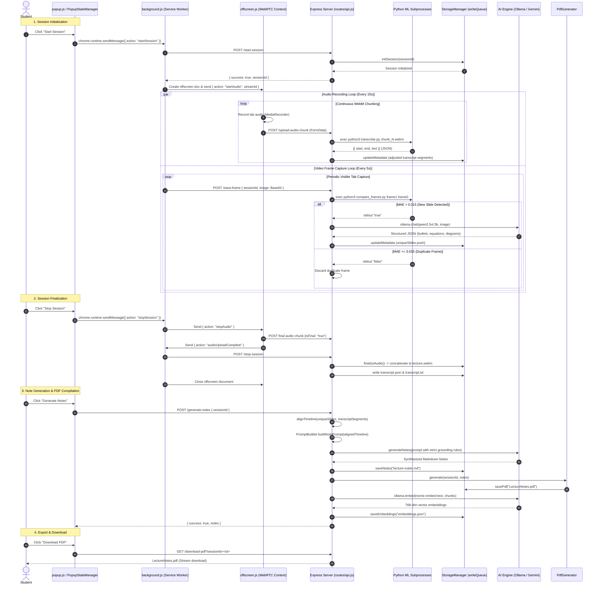
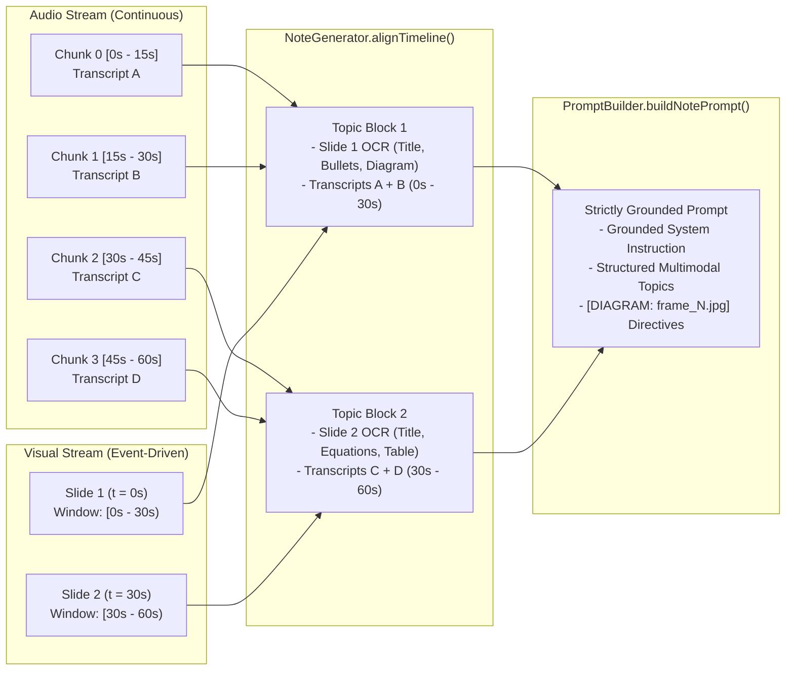
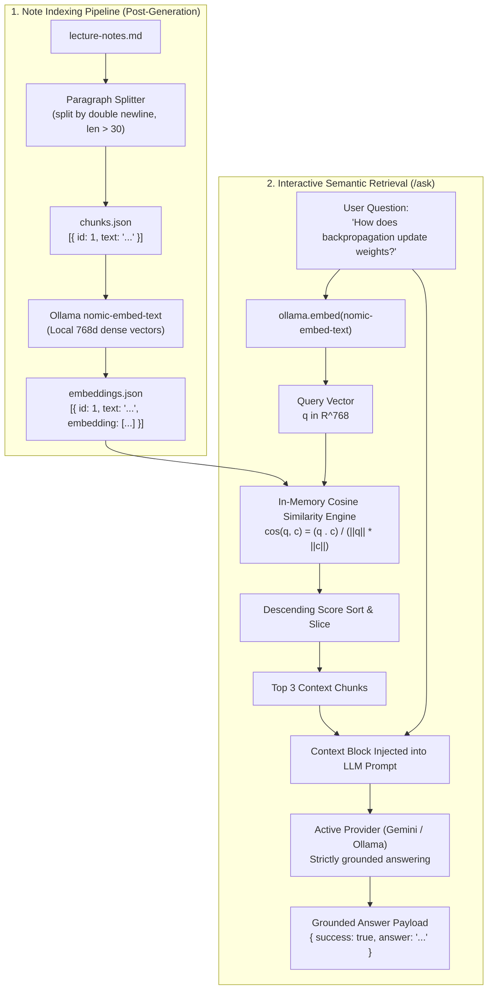
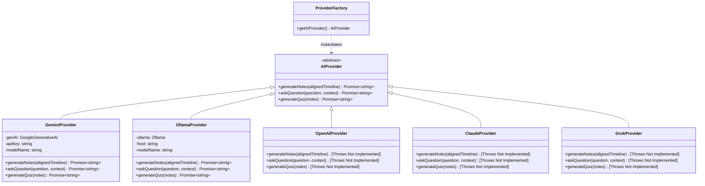

# Mermaid System Architecture & Sequence Diagrams

This document contains Mermaid diagrams modeling the actual implementation of the **AI Multimodal Notes Generator**.

---

## 1. Complete System Architecture Diagram

```mermaid
flowchart TB
    subgraph ClientLayer["Frontend Client (Chrome Extension - Manifest V3)"]
        PopupUI["Popup Interface<br/>(popup.html / popup.js)"]
        PopupState["State Machine<br/>(PopupStateManager.js)"]
        ClientStorage["Client Storage Wrapper<br/>(StorageManager.js)"]
        ClientSession["Client Session Coordinator<br/>(SessionManager.js)"]
        OffscreenDoc["Offscreen Document<br/>(offscreen.html / offscreen.js)"]
        BackgroundWorker["Background Service Worker<br/>(background.js)"]
        
        PopupUI <--> PopupState
        PopupState <--> ClientStorage
        PopupUI --> ClientSession
        ClientSession --> BackgroundWorker
        ClientSession --> OffscreenDoc
    end

    subgraph ChromeAPIs["Chrome Browser APIs"]
        TabCaptureAPI["chrome.tabCapture<br/>(getMediaStreamId)"]
        TabsAPI["chrome.tabs<br/>(captureVisibleTab)"]
        LocalStorageAPI["chrome.storage.local"]
        OffscreenAPI["chrome.offscreen<br/>(createDocument)"]
    end

    ClientSession -.-> TabCaptureAPI
    ClientSession -.-> TabsAPI
    ClientSession -.-> OffscreenAPI
    ClientStorage -.-> LocalStorageAPI

    subgraph BackendGateway["Node.js / Express Server (Port 3000)"]
        ServerCore["Express App Bootstrap<br/>(server.js)"]
        CorsMiddleware["CORS Middleware<br/>(cors)"]
        JsonParser["JSON Parser (limit: 20MB)<br/>(express.json)"]
        MulterStorage["Multer Streaming DiskStorage<br/>(multer)"]
        ApiRouter["REST API Router<br/>(routes/api.js)"]

        ServerCore --> CorsMiddleware
        ServerCore --> JsonParser
        ServerCore --> ApiRouter
        ApiRouter --> MulterStorage
    end

    subgraph ControllerLayer["Controllers"]
        SessionCtrl["SessionController.js"]
        FrameCtrl["FrameController.js"]
        AudioCtrl["AudioController.js"]
        NotesCtrl["NotesController.js"]
        
        ApiRouter --> SessionCtrl
        ApiRouter --> FrameCtrl
        ApiRouter --> AudioCtrl
        ApiRouter --> NotesCtrl
    end

    subgraph ServiceLayer["Service & Processing Orchestration"]
        BackendSessionMgr["SessionManager.js"]
        SlideExtractSvc["SlideExtractor.js"]
        SpeechTranscriberSvc["SpeechTranscriber.js"]
        NoteGenSvc["NoteGenerator.js"]
        PdfGenSvc["PdfGenerator.js"]
        PromptBld["PromptBuilder.js"]

        SessionCtrl --> BackendSessionMgr
        FrameCtrl --> BackendSessionMgr
        AudioCtrl --> BackendSessionMgr
        NotesCtrl --> BackendSessionMgr
        NotesCtrl --> NoteGenSvc

        BackendSessionMgr --> SlideExtractSvc
        BackendSessionMgr --> SpeechTranscriberSvc
        BackendSessionMgr --> NoteGenSvc
        NoteGenSvc --> PromptBld
        NoteGenSvc --> PdfGenSvc
    end

    subgraph SubprocessLayer["Python & Native ML Workers"]
        FrameCompWorker["compare_frames.py<br/>(PIL + NumPy MAE)"]
        WhisperWorker["transcribe.py<br/>(faster-whisper INT8 CPU)"]
        
        SlideExtractSvc -->|child_process.exec| FrameCompWorker
        SpeechTranscriberSvc -->|child_process.exec| WhisperWorker
    end

    subgraph StorageLayer["Session Filesystem Storage"]
        DiskManager["StorageManager.js<br/>(writeQueue Promise Chain)"]
        SessionStore["backend/sessions/<sessionId>/<br/>- frames/*.jpg<br/>- audio/*.webm<br/>- lecture.webm<br/>- session_metadata.json<br/>- lecture-notes.md<br/>- LectureNotes.pdf<br/>- chunks.json<br/>- embeddings.json"]
        
        BackendSessionMgr --> DiskManager
        SlideExtractSvc --> DiskManager
        SpeechTranscriberSvc --> DiskManager
        NoteGenSvc --> DiskManager
        PdfGenSvc --> DiskManager
        DiskManager --> SessionStore
    end

    subgraph AIProviderLayer["AI Providers & External Engines"]
        ProviderFactory["Provider Factory<br/>(providers/index.js)"]
        GeminiEng["GeminiProvider.js<br/>(gemini-2.5-flash)"]
        OllamaEng["OllamaProvider.js<br/>(qwen3:4b)"]
        OllamaVision["Ollama Vision Engine<br/>(qwen2.5vl:3b)"]
        OllamaEmbed["Ollama Embedding Engine<br/>(nomic-embed-text)"]

        NoteGenSvc --> ProviderFactory
        NotesCtrl --> ProviderFactory
        ProviderFactory --> GeminiEng
        ProviderFactory --> OllamaEng
        SlideExtractSvc --> OllamaVision
        NoteGenSvc --> OllamaEmbed
        NotesCtrl --> OllamaEmbed
    end

    %% Network Connections
    ClientSession -->|POST /save-frame<br/>Base64 JPEG| ApiRouter
    OffscreenDoc -->|POST /upload-audio-chunk<br/>Multipart WebM| ApiRouter
    ClientSession -->|POST /start-session<br/>POST /stop-session| ApiRouter
    PopupUI -->|POST /generate-notes<br/>GET /download-pdf<br/>POST /ask| ApiRouter
```

---

## 2. End-to-End Multimodal Sequence Diagram

---

## 3. Multimodal Temporal Synchronization & Alignment Flow

---

## 4. RAG Vector Indexing & In-Memory Cosine Retrieval Flow

---

## 5. Class Diagram: AI Provider Abstraction Pattern

